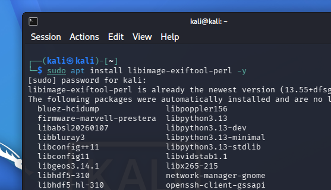
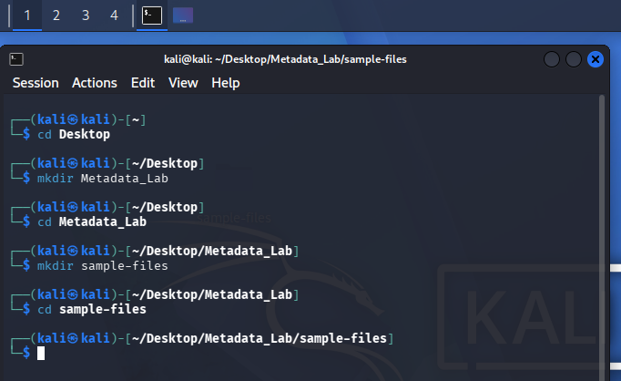
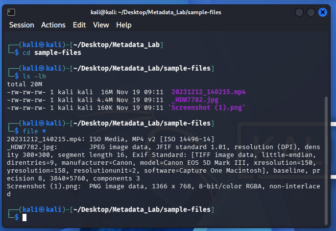
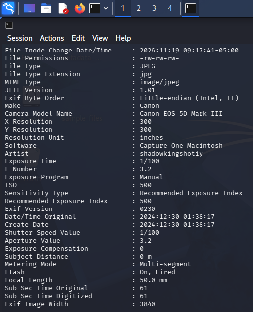
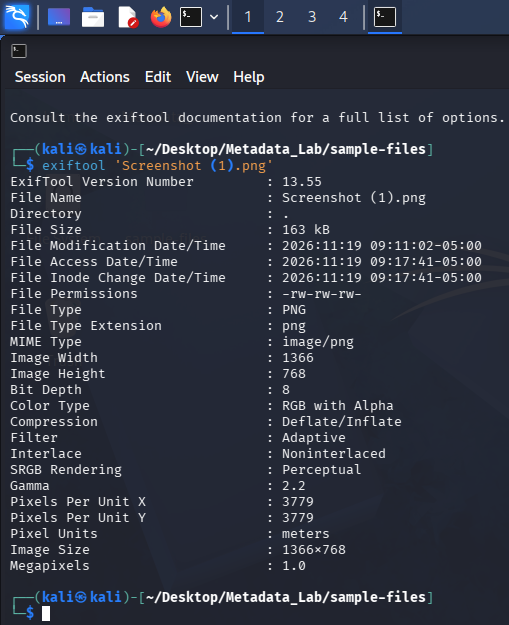
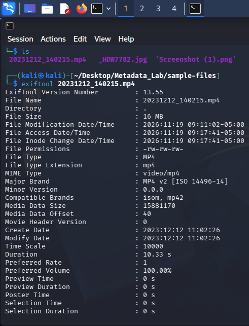
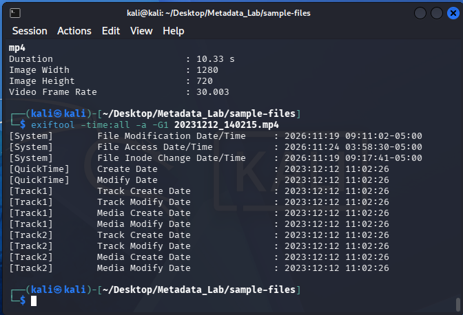
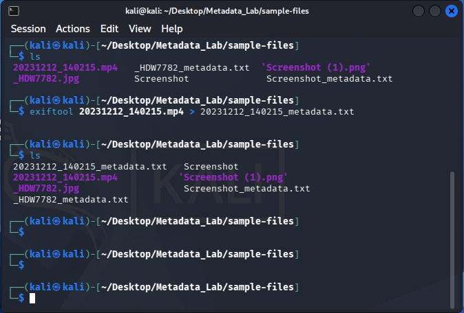
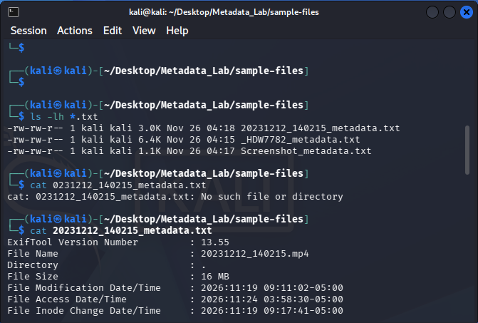

# Extracting Image and Video Metadata Using Kali Linux
## Project Description

A practical digital forensics investigation project demonstrating how to extract, analyze, and interpret image and video metadata using Kali Linux and forensic tools such as **ExifTool**.

The project explores how metadata can reveal valuable digital footprints, including timestamps, device information, file properties, and potential geolocation data. These details support digital investigations, cybercrime analysis, and digital evidence examination.

## Practical Guide

This practical demonstrates how to investigate digital files by extracting and examining embedded metadata to understand their properties and identify potentially useful forensic information.

### Objectives

By the end of this practical, you should be able to:

1. Understand digital footprints and metadata in multimedia files.
2. Identify image and video file properties using Kali Linux.
3. Install and use ExifTool for metadata extraction.
4. Examine timestamps, camera information, file details, and available GPS coordinates.
5. Interpret metadata for digital forensic investigations.
6. Document findings and present forensic observations.

## Tools and Technologies

- **Operating System:** Kali Linux
- **Primary Tool:** ExifTool
- **Investigation Area:** Digital Forensics
- **Evidence Types:** Images and Videos

## Ethical Considerations

All investigations should be conducted using legally obtained files and with appropriate authorization. Digital evidence should be handled responsibly to preserve its integrity and maintain privacy.
# Step-by-Step Guide

## 1. Start Kali Linux

- Start your Kali Linux virtual machine or physical computer.
- Log in to your account.
- Open the Terminal using the keyboard shortcut:

```bash
Ctrl + Alt + T
```

## 2. Install ExifTool

Run the following command to install ExifTool:

```bash
sudo apt update
sudo apt install libimage-exiftool-perl -y
```


## 3. Verify ExifTool Installation

Run:

```bash
exiftool -ver
```

If the installation is successful, the terminal will display the installed ExifTool version.


## 4. Create a Working Directory

Create a folder for the practical on your desktop:
Move to Desktop
```bash
cd Desktop
```

Create the folder:
```bash
mkdir Metadata_Lab
```

Navigate into the folder:
```bash
cd Metadata_Lab
```

Inside `Metadata_Lab` folder Create the folder `sample-files` and Navigate into the folder:
```bash
mkdir sample-files
cd sample-files
```



## 5. Add Sample Files

Prepare the following sample files:

- One JPG/JPEG image.
- One PNG image.
- One MP4 video.

You may use photographs taken with your phone or other sample media you have permission to examine. Transfer or copy all the files into the `sample-files` folder using the Kali Linux File Manager.

## 6. Verify the Sample Files and Identify the File Types

Run:
```bash
ls -lh
```
This command lists the files in the working directory, together with their sizes and permissions.

Run:
```bash
file *
```
Examine the output and identify:
- The JPEG image files.
- The PNG image file.
- The MP4 video file.
- The file sizes and formats.


**Observation:** Record the file types and sizes. Note that a file extension does not always indicate its actual file format.

# 7. Extract Image & Video Metadata

Extract metadata from each image using ExifTool.

**For JPEG:**

```bash
exiftool photo1.jpg
```


**For PNG:**

```bash
exiftool photo2.png
```


Examine the output and identify the following information where available:

- Camera manufacturer and model.
- Date and time the image was created or captured.
- Image dimensions (width and height).
- File format.
- Software used to create or edit the image.
- GPS information, if available.

**Observation:** Compare the metadata from the JPEG and PNG files. Note that PNG images may contain metadata but do not necessarily have the same EXIF information as JPEG images.

### Extract Video Metadata

Run ExifTool against the sample MP4 video:

```bash
exiftool video.mp4
```


Examine the output and identify the following information where available:

- Video creation date.
- Video duration.
- Video dimensions.
- Frame rate.
- Video codec.
- Audio information.
- Device or software information.

### Display Selected Video Properties

Run:

```bash
exiftool -Duration -ImageWidth -ImageHeight -VideoFrameRate video.mp4
```

Record the information displayed.

### Examine Video Timestamps

Run:

```bash
exiftool -time:all -a -G1 video.mp4
```


This command displays available time-related metadata and groups the results by metadata category.

**Observation:** Compare the timestamps and consider whether they necessarily represent the actual time the video was recorded.

# 8. Investigate GPS Location Information

GPS metadata can provide useful geographical information about where a photograph may have been captured. Do this for all your images and video.

### Extract GPS Metadata

Run:

```bash
exiftool -gps:all photo1.jpg
```

For a more detailed examination, run:

```bash
exiftool -G1 -a -s -gps:all photo1.jpg
```

To examine all image metadata, run:

```bash
exiftool -G1 photo1.jpg
```

Look for the following information where available:

- GPS latitude.
- GPS longitude.
- GPS altitude.
- GPS date and time.
- GPS positioning information.

**Observation:** If no GPS coordinates are displayed, the photograph may not contain geographical location information. Mine did not have GPS information.

### Display GPS Coordinates in Numerical Format

Run:

```bash
exiftool -n -GPSLatitude -GPSLongitude photo1.jpg
```

The `-n` option displays numerical values instead of formatted GPS coordinates.

**Note:** GPS metadata may be incomplete. The presence of a GPS Version ID alone does not confirm that actual geographical coordinates are available.

# 9. Save Metadata Investigation Results in files

You can save the extracted metadata into text files for documentation and further analysis. **Try this with all your files and ensure you are in the right folder.** 

### Export Image Metadata

Run:

```bash
exiftool photo1.jpg > photo1_metadata.txt
```

### Export Video Metadata

Run:

```bash
exiftool video.mp4 > video_metadata.txt
```

### Confirm That the Reports Were Created

Run:

```bash
ls -lh *.txt
```


### View the Reports

For the image report:

```bash
cat photo1_metadata.txt
```

For the video report:

```bash
cat video_metadata.txt
```


**Expected Outcome:** You should have separate text reports containing the extracted image and video metadata.

# 10. Demonstrate Metadata Removal

Metadata can sometimes contain sensitive information. In this activity, you will create a copy of an image with its metadata removed. **Try this with all your files and ensure you are in the right folder.**

Run:

```bash
exiftool -all= -o cleaned_photo.jpg photo1.jpg
```

This command creates a new image called `cleaned_photo.jpg` with metadata removed where supported. The original image remains unchanged.

### Compare the Original and Cleaned Images

Examine the original:

```bash
exiftool photo1.jpg
```

Examine the cleaned image:

```bash
exiftool cleaned_photo.jpg
```

Compare the results and identify which metadata fields have been removed or retained.

**Important:** Always preserve original digital evidence and perform forensic examinations on working copies. Metadata removal may also affect some technical file information, so verify the resulting file.

# 11. Key Lessons and Takeaways

### Digital Footprints

Digital files can reveal information beyond what is visible to the human eye. Metadata may expose device details, timestamps, software information, and geographical coordinates.

### Digital Forensics

Metadata analysis can support digital investigations. However, timestamps and other metadata should not automatically be treated as conclusive evidence because they can be modified or manipulated.

### Privacy and Information Security

Individuals and organizations should inspect digital files for sensitive metadata and, where appropriate, remove it before sharing or publishing them.

### Conclusion

Through this practical, you have learned how to use Kali Linux and ExifTool to:

1. Extract image and video metadata.
2. Examine file properties and timestamps.
3. Investigate available GPS information.
4. Export metadata investigation reports.
5. Remove metadata from a copy of an image.

Metadata analysis is an important skill in digital forensics, cybersecurity investigations, and digital privacy protection. By using Kali Linux and ExifTool, investigators can uncover useful information embedded within multimedia files, helping them understand digital activities and establish potential investigative leads.

## Prepared by Mr. Jefferson Mwatati
